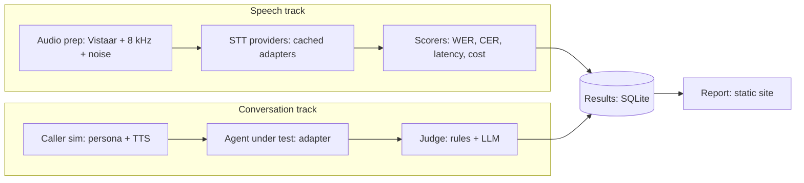

# Indic Voice Benchmark + Open Eval Harness — Project Plan

An open-source Go harness that (1) benchmarks speech-to-text providers on Indic audio under telephony conditions and (2) evaluates conversational voice agents using simulated callers and a calibrated LLM judge.

**Goal:** a public, reproducible project for the resume's Projects section, with hard numbers for every bullet.
**Principle:** build everything from scratch on public or synthetic data. Do not reuse employer code, recordings or prompts.

---

## 1. Scope for v1

| Item | v1 decision |
|---|---|
| Languages | Hindi, Kannada, Hinglish |
| Audio conditions | clean, 8 kHz telephony, telephony + noise |
| Utterances | ~200 per language per condition |
| STT providers | 3–4 (start with ones you already have API access to) |
| Conversation scenarios | ~20, each run 5 times |
| Human-labelled calls | 50 (hard cap) |

**Out of scope for v1:** more languages, speech-to-speech agents, a hosted web app, training or fine-tuning models.

---

## 2. Architecture



---

## 3. Stack and rationale

- **Go** for the runner and CLI: provider calls are concurrent I/O, and it adds to your Go portfolio.
- **SQLite** for results: contributors can clone and run with no database setup.
- **ffmpeg** for the telephony simulation: resample to 8 kHz, apply G.711, mix noise at fixed SNRs.
- **Static report site** generated from the DB, hosted on GitHub Pages.
- **WER/CER written by hand** in Go (Levenshtein). Small, and it teaches you where Indic text breaks the metrics.

---

## 4. Repo layout

```
cmd/evalctl/          CLI: prep, run, score, report
internal/audio/       ffmpeg degrade pipeline
internal/providers/   stt/, tts/, llm/ adapters (one interface each)
internal/scoring/     wer.go, cer.go, normalize.go, judge.go
internal/store/       sqlite schema + queries
scenarios/            YAML: goal, persona, language, success criteria
data/                 manifests only (never commit audio)
web/                  report generator
README.md
LICENSE               MIT
```

---

## 5. Data sources

| Source | Use |
|---|---|
| **Vistaar** (AI4Bharat, MIT) | Primary: bundles Kathbath, FLEURS, CommonVoice, IndicTTS, MUCS, GramVaani benchmarks across 12 languages |
| **Kathbath** | ~1,684 hours of labelled speech in 12 Indian languages; includes a noisy variant (Kathbath-Hard) |
| **IndicVoices, Lahaja, Shrutilipi** | Optional extras from the AI4Bharat catalog; IndicVoices is closer to spontaneous speech. Check each dataset card |
| Synthetic scenarios + TTS | Conversation track: LLM-generated scenarios, caller audio rendered with a TTS provider |

**Licensing:** use the original repos and papers, not third-party repackagings (some leave the license unspecified). Cite Vistaar and Kathbath in the README. Never commit audio; commit manifests only.

**Known gap:** these sets are mostly read speech, while real calls are spontaneous 8 kHz telephony audio. Mitigate with the degrade pipeline and report telephony results separately.

---

## 6. Data model (SQLite)

- `providers(id, kind, name, version)`
- `utterances(id, dataset, language, ref_text, audio_path)`
- `stt_runs(id, utterance_id, provider_id, condition, hypothesis, latency_ms, cost)`
- `scenarios(id, language, persona, goal, criteria_json)`
- `calls(id, scenario_id, agent_id, run_index, transcript_json, audio_path)`
- `scores(id, target_type, target_id, scorer, value, detail_json)`
- `human_labels(id, call_id, label, labeled_at)`

Cache every provider response keyed by (provider, input hash) so reruns are free and results are reproducible.

---

## 7. Metrics and pitfalls

- **WER and CER:** report both. Indic scripts and agglutinative words make WER harsh; CER is the fairer secondary number.
- **Normalization** decides the results: Unicode NFC, strip punctuation, standardize numerals. For Hinglish, fix a rule for Devanagari vs Latin spellings of the same word and document it, or providers get penalized for script choice instead of accuracy.
- **Latency:** p50 and p95. **Cost:** per audio minute.
- **Conversation pass rate:** over 5 runs per scenario, with a confidence interval (not a single pass/fail).
- **Judge calibration:** hand-label 50 calls; report agreement (Cohen's kappa) between judge and human. Re-label 20 calls days later to measure your own consistency.

---

## 8. Milestones

### M1 — Speech track end to end
- [ ] Repo, license, README skeleton, CI (build + test)
- [ ] Download one Vistaar Hindi subset; write the manifest
- [ ] One STT adapter behind the provider interface
- [ ] WER/CER + normalization with unit tests
- [ ] `evalctl run && evalctl score` prints WER

**Done when:** a single command reproduces a Hindi WER number.

### M2 — Full speech benchmark
- [ ] ffmpeg degrade pipeline (clean / 8 kHz / 8 kHz + noise)
- [ ] 3–4 provider adapters, response cache, retries, rate limits
- [ ] Hindi, Kannada, Hinglish manifests
- [ ] Latency and cost capture
- [ ] First report page published on GitHub Pages

**Done when:** the results table (provider × language × condition) is public.

### M3 — Conversation track
- [ ] Scenario YAML schema + ~20 scenarios
- [ ] Caller simulator (LLM persona + TTS)
- [ ] Agent adapter interface (one reference agent)
- [ ] Rule-based scorers (task completion, required fields, forbidden phrases)
- [ ] 5 runs per scenario, pass rate with confidence interval

**Done when:** all scenarios run 5× and the report shows pass rates.

### M4 — Judge and calibration
- [ ] LLM judge with a written rubric
- [ ] Label 50 calls; store in `human_labels`
- [ ] Compute kappa; re-label 20 for self-consistency
- [ ] README states judge agreement honestly

**Done when:** judge reliability is reported alongside every judged score.

---

## 9. Setup checklist

- [ ] API keys for STT, TTS and LLM providers, each with a spending cap
- [ ] Go, ffmpeg, Hugging Face CLI installed
- [ ] New GitHub repo (MIT), README citing Vistaar and Kathbath
- [ ] `.gitignore` for `data/` audio and `.env`

---

## 10. Risks

| Risk | Mitigation |
|---|---|
| Provider API cost | Small subset, caching, spending caps |
| Read speech ≠ real calls | Telephony degrade + report conditions separately; state the limitation in the README |
| Labelling effort | Hard cap of 50 calls |
| Normalization disputes (Hinglish) | Write the rules down; keep them in code with tests |
| Scope creep | v1 cuts in section 1 are fixed until M4 is done |

---

## 11. Deliverables

- Public repo with reproducible CLI
- Benchmark results page (GitHub Pages)
- README: method, limitations, how to add a provider or agent
- Short write-up of findings

**Resume bullet (fill in the numbers):** Built an open-source Indic voice benchmark in Go: X STT providers across Y utterances under telephony and noisy conditions; LLM judge agreement with human labels of κ = Z.

---

## 12. Next iteration (design before code)

1. ERD for the schema above
2. Provider-adapter interface (STT / TTS / LLM / agent)
3. Scenario YAML schema and judge rubric draft
